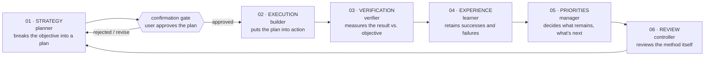

# Agentic loop

Same six-stage recursive cycle as the `onelike-agentic` frontend, run independently in this repo. Each stage is a dedicated subagent in [`.claude/agents/`](./.claude/agents). The loop runs indefinitely, pausing for human confirmation once per cycle, right after planning.

## The stages

| # | Agent | Role |
|---|-------|------|
| 01 | [`planner`](./.claude/agents/planner.md) | Breaks the objective down into a realistic, scoped plan for this Spring Boot backend |
| — | **user** | **Confirms or edits the plan** — mandatory gate, see below |
| 02 | [`builder`](./.claude/agents/builder.md) | Implements the confirmed plan (entities, repositories, services, controllers) |
| 03 | [`verifier`](./.claude/agents/verifier.md) | Measures the result against the objective — runs `mvn test`/build, checks the actual code |
| 04 | [`learner`](./.claude/agents/learner.md) | Retains what worked and what didn't |
| 05 | [`manager`](./.claude/agents/manager.md) | Decides what remains and what to tackle next |
| 06 | [`controller`](./.claude/agents/controller.md) | Reviews the loop's method itself, checks the confirmation gate was honored |

`controller` hands back to `planner`, closing the cycle.

## The confirmation gate (mandatory)

Identical rule to the frontend: every time `planner` produces a new plan, the orchestrating assistant must present it to the user in plain terms and get explicit confirmation before `builder` starts. Never assume a "yes." If the user gives a partial/by-item selection, scope `builder` to exactly what was confirmed — nothing more.

### Change after confirmation

The user is the gate authority and never needs approval to change their own mind mid-cycle. But the gate exists for two things — consent *and* a grounding pass — and a change that skips the grounding pass costs the cycle. So:

- A user-originated change that touches **entity shape, a constraint or unique key, or `bridge`’s pinned contract** goes back through `planner` for a short grounding pass. It does not go to `builder` as a fix pass.
- The test to apply: *would `ddl-auto=update` leave something stale, or would the wire spec change?* If yes, re-plan.
- Anything smaller — a value, a message, a validation bound — can go straight to `builder`.
- Either way, reason out the consequences yourself and tell the user what you found. Spotting a consequence and not surfacing it is the real failure; surfacing it is what keeps the gate a gate rather than a question queue.

`bridge` runs *after* the gate by design, so its own decisions are not gate violations (see "Cross-repo work"). Escalate a `bridge` decision to the user when it changes the wire shape, the DB schema, or user-visible behaviour; resolve naming and internal-only choices yourself and record them.

### Parked plans

**A plan parked without a stated reason is missing information, not a rejected plan.** Before re-planning it or presenting it again, ask the user one direct question about what blocked it, offering the constraints you think it might be. The answer is usually an environment or permission fact rather than a design objection — record it in `LEARNINGS.md` as a constraint once you have it.

A parked plan is carried by `manager` as a **human-only actions** row (status: parked, reason unknown), never as an ordinary backlog row. That misclassification is why the test-isolation item survived four cycles: as a backlog row it competed with features and lost every time, when one question would have unblocked it.

## Permission denials

A denied tool call is a decision, not an obstacle. **No stage — and not the orchestrating assistant — may route around a permission denial on another agent’s behalf**, even when the blocked action was authorised in conversation a moment earlier. Doing so launders a decision that belongs to the user.

When blocked: prefer a non-destructive equivalent that still produces evidence (see `verifier`’s scratch-schema rule), then surface the blocked action to the user with the exact command and what breaks if it is skipped.

## Landing the cycle

A cycle is not closed until its work is committed, or the human-only actions table records why it is not. No stage owns "land the work" otherwise: `manager` carries it as a backlog item where it competes with features and always loses, while `verifier` never gets the clean baseline it needs. Three consecutive cycles ended dirty before this rule was written.

**When.** Landing happens **after stage 06**, not when `verifier` passes, and the commit includes the cycle’s code, the `LEARNINGS.md` entry and any process edits approved at stage 06. Committing at stage 03 leaves the entry and the amendments dirty — exactly the pattern this rule exists to kill, and it happened once after the rule was written.

**Who, and with what authority.** The orchestrating assistant commits; no subagent does. Scope is only the files in this cycle’s confirmed plan — stage the paths explicitly, never `git add -A`. Show the user the commit message. **Commit yes, push never**: pushing is always the user’s own action. Standing authorisation is **session-scoped and asked for once** — ask at the first landing of a session, then land subsequent cycles without asking again unless the user says otherwise. "The rule says cycles must be landed" is a completion criterion, not permission; do not read it as consent.

## Cross-repo work

Some objectives span this backend and the `onelike-agentic` frontend (a new API endpoint plus the frontend code that calls it). For those:

1. `planner` (in whichever repo the objective originated) scopes both sides but does not assume the wire contract — it flags "needs bridge" for anything touching the frontend/backend boundary.
2. Once the user confirms the plan, invoke [`bridge`](./.claude/agents/bridge.md) **before** either side's `builder` starts. `bridge` pins down the exact contract — request/response JSON shape, field names and types, HTTP method and path, identity fields expected, CORS — as a short written spec both `builder`s work from. This exists because the two repos' `builder`s never see each other's code by default; without `bridge`, one side's assumptions can silently drift from the other's actual implementation.
3. Backend `builder` and frontend `builder` each implement their side against `bridge`'s spec, independently.
4. `verifier` (in each repo, or `bridge` again if a fresh check is warranted) confirms the two sides actually agree — not just that each compiles/builds on its own.

## How to run it

Same procedure as the frontend's AGENTIC-LOOP.md: invoke `planner` with the objective, apply the confirmation gate, then run `builder → verifier → learner → manager → controller` in sequence, each fed the prior stage's output. Insert `bridge` between confirmation and `builder` whenever the objective is cross-repo.

`learner` and `controller` are read-only by definition, so they cannot write their own output: the orchestrating assistant appends `learner`’s note to `LEARNINGS.md` verbatim as a new dated entry before invoking `manager`, and applies `controller`’s approved process recommendations at stage 06 — immediately, as their own small confirmed change. **Approved process edits are never queued behind a feature cycle**; two of them went unwritten for a cycle because they were bundled into one the user parked.
