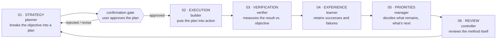

# Agentic loop

Same six-stage recursive cycle as the `onelike-agentic` frontend, run independently in this repo. Each stage is a dedicated subagent in [`.claude/agents/`](./.claude/agents). The loop runs indefinitely, pausing for human confirmation once per cycle, right after planning.

## The stages

| # | Agent | Role |
|---|-------|------|
| 01 | [`planner`](./.claude/agents/planner.md) | Breaks the objective down into a realistic, scoped plan for this Spring Boot backend |
| — | **user** | **Confirms or edits the plan** — mandatory gate, see below |
| 02 | [`builder`](./.claude/agents/builder.md) | Implements the confirmed plan (entities, repositories, services, controllers) |
| 03 | [`verifier`](./.claude/agents/verifier.md) | Measures the result against the objective — runs `mvn test`/build, checks the actual code |
| 04 | [`learner`](./.claude/agents/learner.md) | Retains what worked and what didn't |
| 05 | [`manager`](./.claude/agents/manager.md) | Decides what remains and what to tackle next |
| 06 | [`controller`](./.claude/agents/controller.md) | Reviews the loop's method itself, checks the confirmation gate was honored |

`controller` hands back to `planner`, closing the cycle.

## The confirmation gate (mandatory)

Identical rule to the frontend: every time `planner` produces a new plan, the orchestrating assistant must present it to the user in plain terms and get explicit confirmation before `builder` starts. Never assume a "yes." If the user gives a partial/by-item selection, scope `builder` to exactly what was confirmed — nothing more.

## Cross-repo work

Some objectives span this backend and the `onelike-agentic` frontend (a new API endpoint plus the frontend code that calls it). For those:

1. `planner` (in whichever repo the objective originated) scopes both sides but does not assume the wire contract — it flags "needs bridge" for anything touching the frontend/backend boundary.
2. Once the user confirms the plan, invoke [`bridge`](./.claude/agents/bridge.md) **before** either side's `builder` starts. `bridge` pins down the exact contract — request/response JSON shape, field names and types, HTTP method and path, identity fields expected, CORS — as a short written spec both `builder`s work from. This exists because the two repos' `builder`s never see each other's code by default; without `bridge`, one side's assumptions can silently drift from the other's actual implementation.
3. Backend `builder` and frontend `builder` each implement their side against `bridge`'s spec, independently.
4. `verifier` (in each repo, or `bridge` again if a fresh check is warranted) confirms the two sides actually agree — not just that each compiles/builds on its own.

## How to run it

Same procedure as the frontend's AGENTIC-LOOP.md: invoke `planner` with the objective, apply the confirmation gate, then run `builder → verifier → learner → manager → controller` in sequence, each fed the prior stage's output. Insert `bridge` between confirmation and `builder` whenever the objective is cross-repo.
