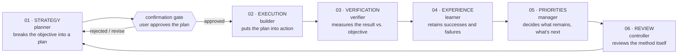

# Agentic loop

Same six-stage recursive cycle as the `onelike-agentic` frontend, run independently in this repo. Each stage is a dedicated subagent in [`.claude/agents/`](./.claude/agents). The loop runs indefinitely, pausing for human confirmation once per cycle, right after planning.

## The stages

| # | Agent | Role |
|---|-------|------|
| 01 | [`planner`](./.claude/agents/planner.md) | Breaks the objective down into a realistic, scoped plan for this Spring Boot backend |
| — | **user** | **Confirms or edits the plan** — mandatory gate, see below |
| 02 | [`builder`](./.claude/agents/builder.md) | Implements the confirmed plan (entities, repositories, services, controllers) |
| 03 | [`verifier`](./.claude/agents/verifier.md) | Measures the result against the objective — runs `mvn test`/build, checks the actual code |
| 04 | [`learner`](./.claude/agents/learner.md) | Retains what worked and what didn't |
| 05 | [`manager`](./.claude/agents/manager.md) | Decides what remains and what to tackle next |
| 06 | [`controller`](./.claude/agents/controller.md) | Reviews the loop's method itself, checks the confirmation gate was honored |

`controller` hands back to `planner`, closing the cycle.

## The confirmation gate (mandatory)

Identical rule to the frontend: every time `planner` produces a new plan, the orchestrating assistant must present it to the user in plain terms and get explicit confirmation before `builder` starts. Never assume a "yes." If the user gives a partial/by-item selection, scope `builder` to exactly what was confirmed — nothing more.

**Any answer the user gives at the gate that settles an open question in a pinned spec is written into that spec, marked settled-at-gate, before `builder` is invoked.** An answer that lives only in the orchestrator’s context is lost to every later stage: in one cycle `manager` re-raised two such answers as still-open contract questions, and they had to be recorded after the fact. This is the same failure as a falsified claim left in its source artefact — see § *Falsifying a claim in an artefact*.

The orchestrator may also **transcribe** a factual correction into comments or doc text — a javadoc paragraph, a spec line — when the wording comes verbatim from a stage’s measurement and **no executable token changes**. That is the same authority `bridge.md` grants for the contract file, extended to source comments. Two conditions: evidence the claim with the sound instrument for it (md5 of the brace-matched method body, per `CLAUDE.md` § *Measurement instruments*) rather than asserting "I changed only the comment", and record it in the cycle’s `LEARNINGS.md` entry. Anything requiring judgement about what the code should do is a `builder` fix pass.

### Change after confirmation

The user is the gate authority and never needs approval to change their own mind mid-cycle. But the gate exists for two things — consent *and* a grounding pass — and a change that skips the grounding pass costs the cycle. So:

- A user-originated change that touches **entity shape, a constraint or unique key, or `bridge`’s pinned contract** goes back through `planner` for a short grounding pass. It does not go to `builder` as a fix pass.
- The test to apply: *would `ddl-auto=update` leave something stale, or would the wire spec change?* If yes, re-plan.
- Anything smaller — a value, a message, a validation bound — can go straight to `builder`.
- Either way, reason out the consequences yourself and tell the user what you found. Spotting a consequence and not surfacing it is the real failure; surfacing it is what keeps the gate a gate rather than a question queue.
- **A change that *removes* work from `builder` only takes effect if it reaches `builder`'s brief.** A mid-run stop-message is best-effort and arrives after the stage has already reached the file. This rule governed routing and was silent on latency, and a cycle lost a user-authored credential in the gap: the user said "I already added the api-key in env", the routing was correct, and the stop-message arrived after the write. So if such a change lands after `builder` has started, treat every file it names as **possibly already written**, measure its state before saying anything to the user about it, and say which instrument you used.

`bridge` runs *after* the gate by design, so its own decisions are not gate violations (see "Cross-repo work"). Escalate a `bridge` decision to the user when it changes the wire shape, the DB schema, or user-visible behaviour; resolve naming and internal-only choices yourself and record them.

### Parked plans

**A plan parked without a stated reason is missing information, not a rejected plan.** Before re-planning it or presenting it again, ask the user one direct question about what blocked it, offering the constraints you think it might be. The answer is usually an environment or permission fact rather than a design objection — record it in `LEARNINGS.md` as a constraint once you have it.

A parked plan is carried by `manager` as a **human-only actions** row (status: parked, reason unknown), never as an ordinary backlog row. That misclassification is why the test-isolation item survived four cycles: as a backlog row it competed with features and lost every time, when one question would have unblocked it.

## Retiring a human-only row

When the user retires a human-only action — "I manage that myself", "that is not a concern" — **record it in `LEARNINGS.md` as a constraint, with their reason, rather than silently dropping it.** A row the orchestrator deletes lives only in its own context, and `LEARNINGS.md` is the only artefact the next cycle’s `manager` re-reads: drop it and the same row is raised again next cycle. Recording it is also not re-escalating it — a retired row is a settled constraint, not an open question, and should never reappear in the backlog or the human-only table.

## Permission denials

A denied tool call is a decision, not an obstacle. **No stage — and not the orchestrating assistant — may route around a permission denial on another agent’s behalf**, even when the blocked action was authorised in conversation a moment earlier. Doing so launders a decision that belongs to the user.

When blocked: prefer a non-destructive equivalent that still produces evidence (see `verifier`’s scratch-schema rule), then surface the blocked action to the user with the exact command and what breaks if it is skipped.

## Landing the cycle

A cycle is not closed until its work is committed, or the human-only actions table records why it is not. No stage owns "land the work" otherwise: `manager` carries it as a backlog item where it competes with features and always loses, while `verifier` never gets the clean baseline it needs. Three consecutive cycles ended dirty before this rule was written.

**When.** Landing happens **after stage 06**, not when `verifier` passes, and the commit includes the cycle’s code, the `LEARNINGS.md` entry and any process edits approved at stage 06. Committing at stage 03 leaves the entry and the amendments dirty — exactly the pattern this rule exists to kill, and it happened once after the rule was written.

**Who, and with what authority.** The orchestrating assistant commits; no subagent does. Scope is only the files in this cycle’s confirmed plan — stage the paths explicitly, never `git add -A`. Show the user the commit message. **Commit yes, push never**: pushing is always the user’s own action. Standing authorisation is **session-scoped and asked for once** — ask at the first landing of a session, then land subsequent cycles without asking again unless the user says otherwise. "The rule says cycles must be landed" is a completion criterion, not permission; do not read it as consent.

## Process fixes: refuse, don’t remind

`builder.md` states it for code — *write a check that refuses rather than a comment that warns* — and it is the best process-design rule this loop has. It is hereby loop-wide, for edits to these files as much as to the codebase:

**Prefer a refusal to a reminder. Where refusal is impossible, pair a prohibition with an after-the-fact visibility mechanism. Never ship a third restatement of a rule that has already failed twice.** A rule that must be remembered at the instant of writing is not a mechanism; five consecutive entries recorded the same orchestrator claim failure *with the rule already written down*, which is evidence about the mechanism, not about anyone’s diligence. Standing prohibitions go in `CLAUDE.md`, which reaches every stage without anyone remembering to write a brief; cycle-scoped ones go in the stage’s brief, and `planner` names them.

## Falsifying a claim in an artefact

When any stage establishes that a claim in `CLAUDE.md`, `LEARNINGS.md` or a pinned contract is **false**, writing the correction into its own output is only half the job. **Name the source: file and line of the claim being falsified.** The orchestrator then applies that edit at stage 06 alongside the process edits, under the same never-queued rule.

The reason is a measured failure, not a hypothetical. One cycle’s `bridge` correctly recorded two false premises in §0 of the contract it was writing — and both had come from `CLAUDE.md`, which stayed wrong, so the same premise was positioned to re-enter the next cycle. A correction that lives only in the downstream artefact fixes one cycle; a correction written back to the source fixes all of them. `bridge`’s output format carries a **source artefact** field for exactly this.

**Correct every instance, and find them by searching the claim’s *subject*.** The falsifying stage reports (a) the file and line it tripped over, (b) the **bare search stem** for the subject, and (c) the full hit list that stem returns across the repo, **source comments included** — not just the artefact it happened to be reading. Search the stem, not the phrase: `minute`, not `ten minutes`. A `ten minutes\|10 minutes\|600000` pattern missed the hyphenated "up-to-ten-minute", and the stage that noticed re-ran it on the stem and found three more. The orchestrator edits every hit, then **re-runs the stem search and reports zero**. One premise survived two correction passes in the same file and was then found a third and a fourth time by two different later stages, because each pass corrected only the instance that had been reported.

**Whose edit it is.** Deleting a false clause and leaving the surviving advice intact is within the orchestrator’s transcription authority. **Inventing a new justification is not** — where the replacement text requires judgement about what the artefact *should* say, that is authorship, and it goes to the stage that owns the artefact (`bridge` for a pinned contract, `builder` for source comments).

**When the replacement text needs judgement and no cycle will touch that file.** The two rules above collide: a falsified source comment is applied at stage 06 and never carried, but a replacement requiring judgement belongs to `builder`, which runs inside a cycle. Riding with the next cycle that touches the file is the resolution that has already been **measured and failed** — two such edits survived six `LEARNINGS.md` entries that way, and the carried row's own text decayed alongside them. So, in order of preference: (i) where the correct replacement wording **already exists verbatim in a sibling artefact**, it is transcription and the orchestrator applies it at stage 06, citing the sibling by `file:line`; (ii) where it must be composed, **stage 06 may commission a comment-only `builder` pass**, scoped to the named `file:line` hits and nothing else, presented with the other stage-06 edits. Its boundary is mechanical, not trusted: **no executable token changes.** `builder` reports md5 of the brace-matched method bodies before and after — and because **no `verifier` runs at stage 06**, the orchestrator re-derives those md5s itself (it has Bash) before committing, and says so. A boundary measured only by the stage it bounds is a trusted boundary wearing a mechanical one's clothes. This is corroboration, not verification: no second instrument exists for a hash, so say "corroborated". The pass may not change behaviour, add a guard, or rename a symbol. (iii) If the correct replacement is **not yet known** because the settling measurement has not been taken, it is an ordinary backlog row whose content is the **measurement** — naming the question, not "fix the comment".

**A comment or spec line that asserts a mechanism and has been measured false is a falsified claim, not a hygiene row** — applied at stage 06, never carried as a backlog or "rides with" row and never ranked against a feature. Two such edits survived six `LEARNINGS.md` entries purely by having been filed as hygiene: known-false text, measured-true replacement available, zero judgement required.

## The orchestrator’s own claims

The orchestrating assistant is not one of the six stages and has no definition file, so nothing else binds it. **Its own measurements and evidence claims meet the same bar it imposes on `planner` and `verifier`.**

There are **two** classes of failure here, and they need different fixes.

**Blind-spot failures** — the instrument cannot see the thing claimed. Before quoting a number or citing a command as evidence, **state what the output would look like if the claim were false.** If it would look identical, the method cannot support the claim. Three real examples, all the orchestrator’s: `information_schema.TABLES.TABLE_ROWS` is an InnoDB estimate, so it cannot serve as a row-count baseline; `git diff --stat` cannot see an untracked file, so it cannot show that a fix pass touched only that file; a `performance_schema` digest is filed under the connection’s default schema, so it cannot alone show which tables were touched.

**Measurement artefacts** — the instrument answers deterministically *wrong*, and **the falsifier test structurally cannot catch them.** A reading of a file’s line endings taken through `git show` reports pure LF for a CRLF file, because git hands back the LF-normalised blob; the true and the false output are *identical in shape*, so no self-written falsifier fires. A CR count taken through the `grep`/`awk` family likewise disagreed with `od -c` and `file -b`. For this class the only defence is a lookup: **check the question against `CLAUDE.md` § *Measurement instruments* before choosing the tool**, and corroborate with a second, different instrument when the claim is load-bearing and the tool is unlisted.

**Write it as a claim row, not a sentence: `number | instrument | what this instrument cannot see`.** This binds every number **and every equality or identity claim** — "these two values are the same", "this file is unchanged", "this is the same secret". A stage once reported `jwt.secret` as "the same committed literal in both repos" when it had compared **placeholder names**, not values; the claim was an equality, so a rule binding only numbers let it through. It binds not only measurements carried into a gate, but **any count asserted in prose** — in a `LEARNINGS.md` entry or in a brief to a stage. Two of this loop’s errors were exactly that: "the error is in the second entry" and "three parse sites", both countable, both stated without an instrument, both caught late by a downstream stage happening to look.

A claim row has **three** possible outcomes, not two: *filled and re-derived with a different instrument* (verified); *filled, but re-derivable only with the same instrument* (corroboration — say so, do not call it verified; a cryptographic fingerprint is the honest example, since no second instrument exists for a hash); or *cannot be filled* (blocked at the point of writing). The third column is the instrument’s **blind spot** — not the claim restated in the instrument’s own units. "If my claim were false the deletion count would be non-zero" is the failure to avoid: it restates the instrument instead of naming what the instrument is blind to, and it was written unprompted, in good faith, and was wrong — because `git diff --numstat` cannot show a *method* is byte-identical at all. 

A self-written falsifier comes from the same reasoning that chose the instrument, so it reads plausible while being empty. The mechanism that has actually worked every time is **adversarial re-derivation with a *different* instrument** by `verifier`: `TABLE_ROWS`→`SELECT COUNT(*)`, `--stat`→`git status` plus a content compare, `--numstat`→md5 of brace-matched method bodies, the digest rule→the three-part claim. So any number the orchestrator measures and carries into the gate, into a verdict, or into a `LEARNINGS.md` entry is a **baseline**: label its instrument and hand it to `verifier`, exactly as `planner`’s numbers are.

### Claims no author may settle unmeasured — orchestrator or stage

The falsifier test above has now failed six cycles running, every time already written down. Four claim **subjects** are therefore off-limits to settle unmeasured. This binds the orchestrator **and any stage authoring a durable artefact** — a pinned contract, a `LEARNINGS.md` entry, a source comment, a stage definition. It was written against the orchestrator alone and failed within hours on exactly that scope: `bridge` wrote *"Absent means only one thing: you are talking to a backend older than this change"* into a pinned contract, with the disconfirming rule — a 409 carries no `themes` — three lines above its own sentence. A durable artefact is read by more people than a report is, so the scope was backwards. The orchestrator may still route such a claim to a stage, or state it to the user as unverified with the blind spot named.

1. **Authorship / provenance** — who wrote these bytes; whether the user did the thing they said they did. Sound: mtime against the message timestamp; a charclass or length that distinguishes the two *generators*; `git log`/`git status` for tracked files. A property check (length, charclass, "the two values differ") is **silent on authorship and reads identical for either author** — which is exactly how one cycle confirmed a user’s credential work by measuring a subagent’s overwrite of it.
2. **Parity / equality** — "the same secret", "unchanged", "byte-identical". Needs md5 of the extracted content, or a human-run comparison where the values are credentials.
3. **Absence** — "appears in no artefact", "no other call site", "absent means X", "nothing writes this column". **This one is a positive obligation, not a prohibition: an absence claim is written with the search that establishes it, inline, in the artefact itself** — the pattern, the scope it ran over, and the hit count. `CONTAINERS-CONTRACT.md:120` is the worked shape: it names the five statuses actually measured and the class they share, so the next reader can see what was *not* measured. A sentence of the form "absent means only X" with no search beside it is **incomplete on its face**, which is the point — the gap is visible to a reader who knows nothing about the cycle, where a prohibition is only visible to an author who remembers it. And a value no stage may hold cannot be searched for at all, which makes such a row impossible rather than open. In a **source comment**, where an inline search would be heavier than the code it annotates, the equivalent is to **name the counter-case the claim excludes**: "a 409 writes no *container row* — `upsertUser` still runs on every branch" is complete, where "a 409 writes nothing" is not. Same principle as naming the five statuses actually measured — show the reader what was *not* covered.
4. **Anything asserted back to the user about their own files or actions.** The trigger is lexical, which is what makes it cheap: **if the sentence’s subject is *you* or *your*, it carries its instrument inline or it is phrased as a question.**

### Generalising past the measured scope

The four subjects above are failures of *missing* measurement, and their remedy is to state the instrument. There is a fifth shape with a different cause and a different remedy: **a measurement taken correctly and then stated wider than it was taken.** Three instances in two cycles, by three different stages:

- `bridge` measured that a 409 carries no `themes`, and wrote "*Absent means only one thing: you are talking to a backend older than this change*" — false of five error statuses, with the disconfirming case three lines above its own sentence.
- `bridge` measured the write-time front-insert, and wrote "*Multiple themes therefore read newest-first, which falls out of the same rule*" — false after a saved reorder (measured on the wire: `Delta, Alpha, …, Gamma, Beta`), with the qualification two sentences later. A client implementing that sentence would have written exactly the local read-time sort the next paragraph says was rejected to avoid.
- `verifier` measured that no released client calls the **container** endpoints; `learner` carried it forward as grounds for lowering the urgency of five parse sites and a `finally` in `articlesOf` — a method the released `GET /service/news` reaches.

Stating the instrument catches none of these. **The remedy is the scope clause:**

**A sentence that generalises a measurement carries, in the same sentence, the scope that was measured — and where the sentence is wider than that scope, the qualifying condition itself, not a cross-reference to it.** "Newest-first" needs *until the user saves an order* **in the sentence**. "Absent means X" needs *measured on these five statuses*. "No released client calls those endpoints" needs *which endpoints*, because a method is not an endpoint. A qualification sitting in the next sentence, the next paragraph, or another file **has now failed twice**: the reader who takes one sentence out of a durable artefact is the normal case, not the careless one.

The trigger is lexical, which is what makes it cheap: **always, never, only, every, therefore, falls out of, which means, so X is just Y**. And one non-lexical trigger worth the extra second: a sentence whose **subject is broader than the subject that was measured** — a *method* where an endpoint was measured, a *status class* where one status was measured, *all users* where one user's rows were counted.

Unlike the four subjects above, this binds **reports as well as durable artefacts**: the third instance travelled in a backlog row and reached `manager` as a ranking input, where a spec-only rule would not have reached it.

**Mechanically — the obligation rides on the sentence, not on a side file.** A session claim ledger was tried and did not survive its first cycle: it was optional bookkeeping owned by the one actor with no definition file and no reviewer between its claims and the user, and the cycle that introduced it kept none. **It is withdrawn, not restated.** In its place: a claim on one of the four subjects above is written **in the artefact that carries it, with its instrument in the same sentence**, or it is phrased as a question. The obligation then attaches to a sentence that is being written anyway, instead of creating a second place that must be written too. `verifier`’s "Numbers and claims I was handed" slot re-derives whatever reached it through a brief — the one mechanism here with a perfect record — and `controller` re-reads the artefacts at stage 06, where an instrument-free claim on one of these subjects shows up as a *textual* absence rather than as a missing row in a file nobody opened. Honest limit, now the only one: a claim made to the user in conversation after stage 03 and never written into any artefact reaches no reviewer at all.

## Cross-repo work

Some objectives span this backend and the `onelike-agentic` frontend (a new API endpoint plus the frontend code that calls it). For those:

1. `planner` (in whichever repo the objective originated) scopes both sides but does not assume the wire contract — it flags "needs bridge" for anything touching the frontend/backend boundary.
2. Once the user confirms the plan, invoke [`bridge`](./.claude/agents/bridge.md) **before** either side's `builder` starts. `bridge` pins down the exact contract — request/response JSON shape, field names and types, HTTP method and path, identity fields expected, CORS — as a short written spec both `builder`s work from. This exists because the two repos' `builder`s never see each other's code by default; without `bridge`, one side's assumptions can silently drift from the other's actual implementation.
3. Backend `builder` and frontend `builder` each implement their side against `bridge`'s spec, independently.
4. `verifier` (in each repo, or `bridge` again if a fresh check is warranted) confirms the two sides actually agree — not just that each compiles/builds on its own.
5. **A pinned spec older than the current cycle is re-checked against both repos’ code, not reused on trust** — and a behavioural change to a pinned field’s *dynamics* invalidates the spec just as a change to its shape would. A later cycle made a theme’s `last_update` move between reads with no user action (a scheduled job writes it), while the spec still described a value that changed only on create. No shape check would have caught that, and the frontend `builder` would have worked from it unaware.

6. **Ordering is two questions, not one.** `bridge` answers "what breaks if A ships first" **and** "what breaks if B ships first", each against the other side's *deployed* code. The asymmetric case is the dangerous one and is invisible to a single-direction answer: a backend change that **tightens a limit, narrows a response, or changes a default** is a regression for every existing user until the client catches up, however carefully the new client is written. One cycle answered "backend first, the frontend is not blocked" — true of the new client's safety against an older backend, and silent on the new backend lowering every existing user's effective theme cap from a flat 10 to a default of 1 while the shipped client had no field to read the new limit from.

## How to run it

**Every brief carries the live text of the `CLAUDE.md` rules the cycle depends on.** The orchestrator composes each brief, and a brief is fresh text — the one channel into a subagent that cannot be stale. So the instrument rows, the prohibitions and the counts a cycle turns on are quoted into the brief from a `Read` taken this cycle, with `file:line`, instead of being left to the stage's injected copy. `planner`'s checklist 11 already does this for cycle-scoped prohibitions; this extends it to the standing ones, because "standing prohibitions live in `CLAUDE.md`, which reaches every stage without anyone remembering" was true of the file and **not** true of the copy the stage reads — measured: the injected snapshot was missing both credential prohibitions and had the instruments table inverted on `od -c`. Honest limit: a stage silently obeying a stale rule the brief did not quote still reaches no reviewer. Quote the ones that bind this cycle's writes — credentials, env files, and the instruments for every load-bearing number.

Same procedure as the frontend's AGENTIC-LOOP.md: invoke `planner` with the objective, apply the confirmation gate, then run `builder → verifier → learner → manager → controller` in sequence, each fed the prior stage's output. Insert `bridge` between confirmation and `builder` whenever the objective is cross-repo.

`learner` and `controller` are read-only by definition, so they cannot write their own output. The orchestrating assistant appends `learner`’s note to `LEARNINGS.md` verbatim as a new dated entry before invoking `manager`; appends `manager`’s human-only table, reconciled backlog and drop list to that same entry under `### Backlog after this cycle (manager)`; appends `controller`’s process-recommendation list under `### Process review (controller)`, **each row with a completion column it fills in as it applies the edit** (`applied` / `not applied — reason`); and applies `controller`’s approved recommendations at stage 06 — immediately, as their own small confirmed change. **Approved process edits are never queued behind a feature cycle**; two of them went unwritten for a cycle because they were bundled into one the user parked.

Two measured reasons for the two appends. `manager`’s drops lived only in conversation, so the next `learner` rebuilt its carried list from the previous *entry* and twice resurrected rows that had been closed — including two entity javadocs that were already repaired. And `manager.md` correctly forbids inferring a file’s current contents from a previous stage-06 edit list on the grounds that the list “records what was *approved*, not what landed, and **has no completion column**” — adding the column is the fix; prohibiting the inference was only the guard.
